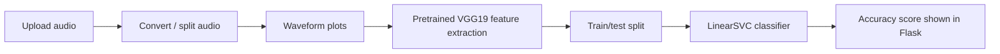

# Audio Classification Prototype — VGG19 Features + Linear SVM

**Python · Flask · Audio Processing · TensorFlow/Keras · scikit-learn · Matplotlib**

This historical proof-of-concept Flask application accepts audio files, splits audio into short segments, plots waveforms as images, extracts image features using a pretrained VGG19 network, and uses a linear support vector machine (SVM) to classify those features.

> **Project status:** Archived learning prototype. It includes hard-coded Windows paths, old TensorFlow/Keras APIs, and incomplete setup instructions. The existing code has not been tested against current package versions; the repository should not be considered a ready-to-run application.

## Pipeline

**Important technical distinction:** VGG19 is used as a pretrained feature extractor here. The classifier trained on the extracted features is `sklearn.svm.LinearSVC`; this project does **not** train the VGG19 neural network end to end. The implementation also uses locally stored plots and simple folder/order-based labels rather than a documented, independently validated benchmark dataset.

## Repository structure

| Path | Purpose |
| --- | --- |
| `app.py` | Registers the upload and machine-learning Flask blueprints |
| `WebApp/main_page.py` | Handles file uploads, audio conversion, segmentation, and waveform plots |
| `MachineLearning/machinelearning.py` | Loads pretrained VGG19 features, trains a linear SVM, and reports accuracy |
| `templates/` | HTML templates for the upload and modeling pages |
| `downloads/` | Sample inputs and intermediate artifacts from the original project |

## Project walkthrough

1. The upload route in `WebApp/main_page.py` accepts a selected audio file and processes it with pydub and SciPy.
2. `extract_audio` creates small WAV segments. `plot_waves` saves plots of the audio samples as images.
3. `MachineLearning/machinelearning.py` loads those images into VGG19 and collects features from the model's flatten layer.
4. A `train_test_split` and `LinearSVC` are used to estimate classification accuracy and display the result in the Flask interface.

**Evaluation caveat:** The labels are constructed within the script using file ordering/folder membership, and the train/test split may contain segments derived from the same original audio. Consequently, the reported accuracy should not be interpreted as demonstrated generalization to unseen recordings. No verified accuracy metric is published here.

## Demo

[Original project video on Vimeo](https://vimeo.com/378198308)

## Reproducing or modernizing

To make this application reproducible, the following changes are required:

- Replace local absolute Windows paths with configurable paths relative to the project directory.
- Migrate legacy TensorFlow graph handling and Keras imports to supported versions.
- Provide a dependency manifest, documented Python version, and automated smoke tests.
- Define a dataset, label mapping, and sound-grouped train/test split that avoids data leakage.
- Validate file input, cap upload size, and replace hard-coded Flask secret keys with environment-based configuration.
- Remove editor caches and generated artifacts from Git tracking where appropriate.

These are improvement opportunities, **not completed fixes**. No current installation or execution steps are claimed until the code and dependencies are verified.

## About

This is an early experimental ML project. For more recent analytics and engineering work, see [my GitHub profile](https://github.com/tariksalay).
