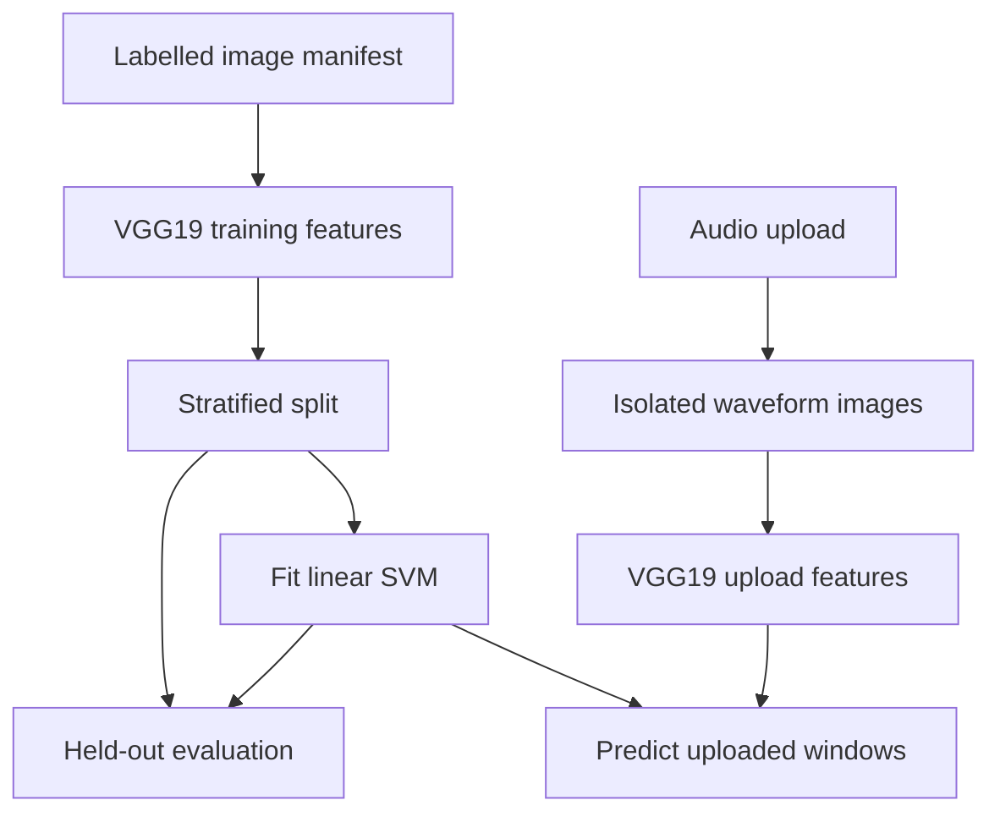

# Audio Classification Prototype: project walkthrough

[Overview](../README.md) · [Code reference](CODE_REFERENCE.md) · [Development guide](DEVELOPMENT.md)

## Read the application in this order

Start at [app.py](../app.py), follow the upload blueprint in [WebApp/main_page.py](../WebApp/main_page.py), then inspect the manifest and classifier workflow in [MachineLearning/machinelearning.py](../MachineLearning/machinelearning.py). The HTML templates expose the upload and training actions; they do not implement the classification logic themselves.

## Repository map

| Path | Responsibility |
| --- | --- |
| [app.py](../app.py) | App factory, secret/configuration defaults, upload root, size and duration limits, blueprint registration |
| [WebApp/main_page.py](../WebApp/main_page.py) | Filename/extension checks, audio decoding, job directories, waveform creation, and session job identifier |
| [MachineLearning/machinelearning.py](../MachineLearning/machinelearning.py) | Manifest validation, lazy VGG19 model, image features, split, SVM, and results |
| [templates](../templates) | Upload and machine-learning page templates |
| [downloads](../downloads) | Preserved historical examples/intermediate files; not the current writable upload directory |
| [tests/test_app.py](../tests/test_app.py) | Route, upload, manifest, and classifier-plumbing checks |
| `instance/uploads/` | Local runtime output, ignored by Git; each job has its own subdirectory |

## Upload path and runtime objects

`create_app(config)` builds a Flask app. A supplied test configuration can override the writable upload root. A temporary random secret is used unless `FLASK_SECRET_KEY` is supplied; the signed session stores a job identifier, not the audio itself.

`upload_file` accepts WAV/MP3 filenames after sanitization, saves the file inside a randomly named job folder, and decodes it with pydub. The body limit is 20 MiB and decoded duration must be positive and at most 60 seconds. Failures clean the newly created job folder. There is no automatic retention policy for successful jobs.

`extract_audio` produces at most 12 overlapping waveform windows from the beginning of the clip: starts are spaced 500 ms apart, with up to 1,500 ms per window. Each mono segment is written as WAV under `audio_parts/`, and its amplitude-over-time plot is written as PNG under `wav_plots/`. These plotting decisions affect the image features; they are not spectrograms.

## Training objects and label contract

`load_training_manifest` reads a CSV whose header is exactly `path,label`. Paths resolve below the manifest's directory and must refer to existing PNG/JPG/JPEG files. Labels must be nonempty. At least two classes and two images in each class are required. Extra or missing fields are rejected.

`feature_model` caches a VGG19-derived Keras model ending at the `flatten` layer. `get_features` resizes an image to 224×224, converts it to an array, applies VGG19 preprocessing, and returns its feature vector. The VGG19 network is not fine-tuned by this application.

`run_machinelearning` extracts labelled-image features, creates a seeded stratified holdout, fits `LinearSVC`, and displays holdout accuracy. If the session has a valid job, it also predicts labels for that job's waveform images. The SVM is trained during the request; it is not a saved deployed model.

## Routes

| Method and path | Handler and result |
| --- | --- |
| `GET /` | `upload_form`: renders the file chooser |
| `POST /` | `upload_file`: validates/processes audio and redirects to the modeling page |
| `GET /machinelearning/` | `upload_machinelearning_form`: renders the training action |
| `POST /machinelearning/machinelearning` | `run_machinelearning`: requires explicit labels, trains/evaluates, and optionally predicts the current upload |

## Interpret the output carefully

A label file can define an experiment, but it does not make those labels reliable. Windows from the same recording can leak recording-specific patterns across an image-level split. Independent recording-level evaluation is still needed. The silent WAV fixture tests handling, not acoustic understanding; mocked features test the SVM path without claiming real VGG19 results. Authentication, CSRF protection, user quotas, and production model serving are not part of this prototype.
